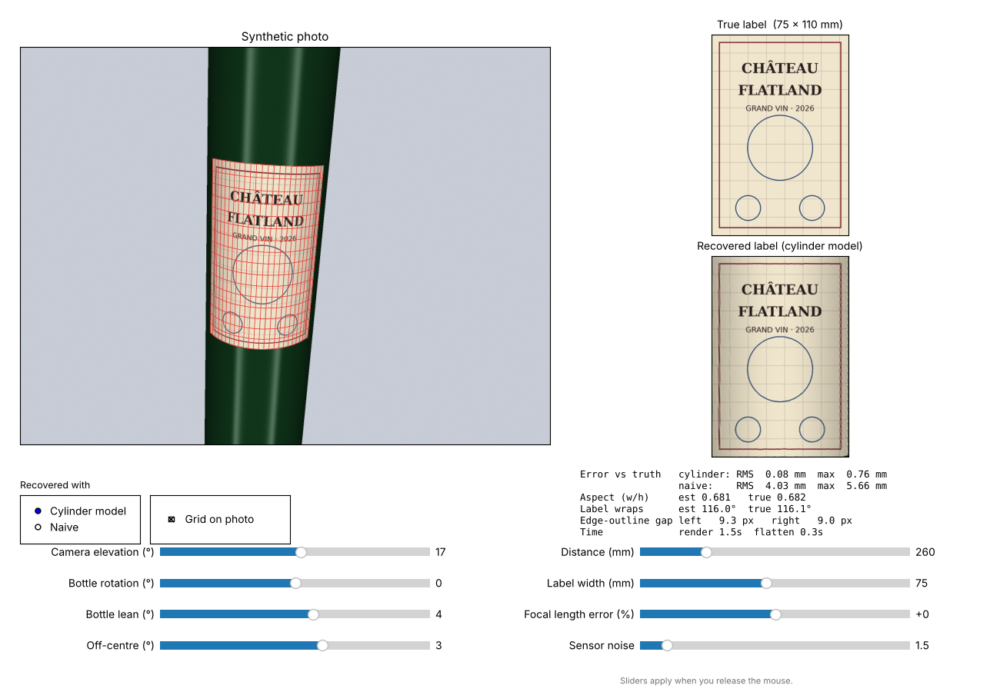
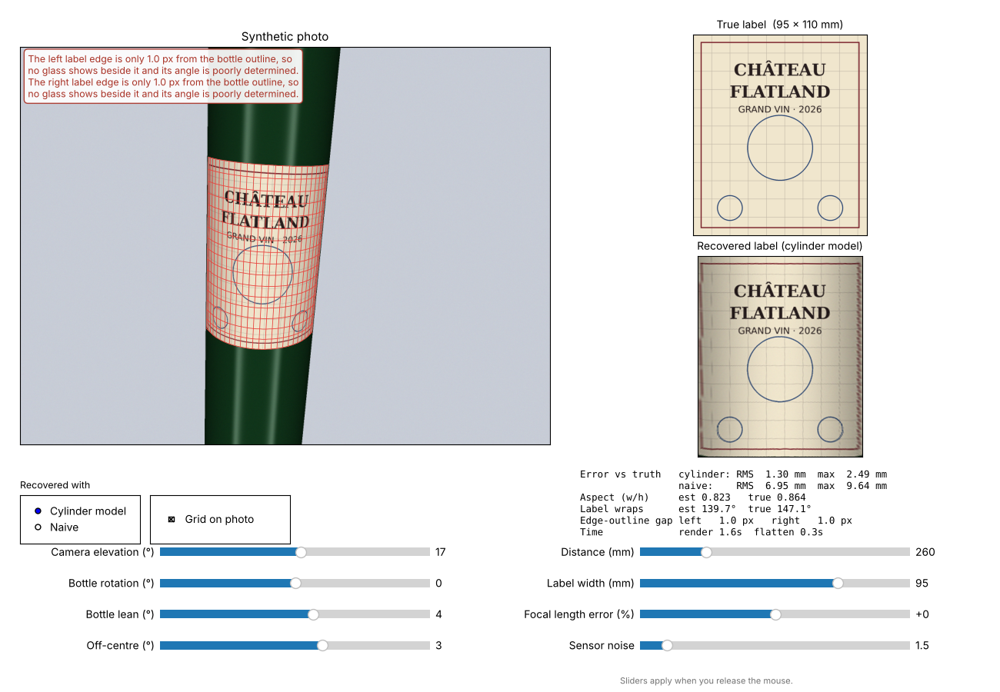

# label-flattener

Recover the flat, rectangular artwork of a wine label from **one photo** of the
bottle, and test how well that works on synthetic bottles where the true label
is known.



## The idea

A label stuck on parallel to the base of a cylindrical bottle is a developable
surface: it unrolls flat without stretching. Given a photo that shows both
vertical edges of the label, the mapping from photo to flat label is fully
determined.

1. **Find the edges.** The two outlines of the bottle and the two side edges of
   the label are straight lines in the photo. The label's top and bottom edges
   are traced as free curves. No ellipse is fitted.
2. **Vertical vanishing point.** All vertical lines on the bottle are parallel
   in 3D, so in the photo they meet at one point, V. A line through V crosses
   the top and bottom edges at points on the *same* vertical line of the label.
3. **Angle around the bottle.** Looking down the bottle's axis, the bottle is a
   circle and the two outlines are tangents to it from the camera. With the
   focal length (from the photo's EXIF data) this fixes where the bottle is,
   and so the true angle around the bottle of every line through V. That angle
   is what spaces the columns correctly. Equal spacing in the photo would
   squash the ends of the label.
4. **Rows.** Along each vertical line the top, the bottom and V fix the
   perspective, so intermediate rows are placed exactly (the cross-ratio).
5. **Grid of homographies.** Each cell of the resulting grid has four exact
   corners and is mapped to a rectangle with a 4-point homography.

The grid nodes are exact. The only approximation is that each cell has
straight sides, and that error falls about 4× each time the cell size halves.
With a 48 × 32 grid it is below 0.05 mm RMS.

## Install

```bash
git clone https://github.com/robfoy-cloud/label-flatenner.git
cd label-flatenner
pip install -r requirements.txt        # or: pip install -e .[test]
```

## Interactive explorer

```bash
python -m labelflat.app
```

Sliders move the camera around a synthetic bottle. The window shows the
rendered photo with the recovered grid, the true label, and the recovered
label beneath it, plus the error in millimetres against the truth. Sliders
apply when you release the mouse. A render takes about 1–2 s.

| Slider | Meaning |
|---|---|
| Camera elevation | camera above (+) or below (−) the label centre |
| Bottle rotation | how far the bottle is spun away from facing the camera |
| Bottle lean | camera roll, so the bottle leans in the frame |
| Off-centre | bottle displaced from the middle of the photo |
| Distance | camera to bottle axis, in mm |
| Label width | the label's flat width; the bottle is 74 mm across |
| Focal length error | how wrong the assumed focal length is |
| Sensor noise | image noise, in grey levels |

Switch **Recovered with** to *Naive* to see the obvious approach instead:
columns at equal spacing in the photo and rows interpolated straight across.

Headless, for scripts or CI:

```bash
python -m labelflat.app --save out.png --elevation 35 --rotation -15 --label-w 85
```

## Use it on your own image

```python
import cv2
from labelflat import flatten

img = cv2.cvtColor(cv2.imread("bottle.jpg"), cv2.COLOR_BGR2RGB)
f_px = 3000.0                    # focal length in pixels, from EXIF
r = flatten(img, f_px)
cv2.imwrite("label.png", cv2.cvtColor(r.image, cv2.COLOR_RGB2BGR))
print("label width / height =", r.aspect)
```

The edge detector in `labelflat/rectify.py` is deliberately simple. It assumes a
plain, light background, dark glass and a light label. Real photos will need
a sturdier detector, or edge points supplied directly via `flatten(..., feats=...)`.

## What the experiments show

Photo 1600 × 1200 px, phone-like lens, 74 mm bottle, camera 26 cm away.
Errors are measured on the label in millimetres, by tracing every output pixel
back through the true geometry.

```bash
python experiments/sweep.py label_w 60 75 85 90 95 100
```

| Label width | Cylinder RMS | Naive RMS | Glass gap beside each edge |
|---|---|---|---|
| 60 mm | 0.04 mm | 3.2 mm | 35 px |
| 75 mm | 0.04 mm | 4.0 mm | 15 px |
| 85 mm | 0.05 mm | 5.1 mm | 7 px |
| 90 mm | 0.08 mm | 5.9 mm | 4 px |
| 95 mm | 0.76 mm | 6.9 mm | 1.7 px |
| 100 mm | 1.41 mm | 7.9 mm | 0.4 px |

**The main limit is how close the label edges get to the bottle's outline.**
Near the outline the surface turns away from the camera, and the image
distance shrinks roughly with the square of the angle. A label edge 12° short
of the outline can be only a couple of pixels from it. Once less than about
3 px of glass shows beside an edge, its angle can't be measured. Typical
labels on 75 cl bottles, about 90 mm wide on a 74 mm bottle, sit right at
this limit. The explorer warns when it happens.



Other findings:

- **Viewing angle:** anything from level to well above or below works. There
  is no ellipse fit to become ill-conditioned when shooting side-on.
- **Focal length:** an error of ±30% barely changes the shape of the flattened
  label, but shifts the width-to-height ratio by 2–4%.
- **Distance:** further away means fewer pixels on the bottle, so errors grow
  slowly.
- **Hidden edges:** if the label wraps past the outline, a corner is out of
  sight and can't be recovered from one photo.

## Layout

```
labelflat/scene.py      synthetic bottle, camera and ray-traced renderer
labelflat/rectify.py    edge detection, cylinder geometry, grid and warping
labelflat/pipeline.py   flatten() and score() against ground truth
labelflat/app.py        interactive explorer
experiments/sweep.py    parameter sweeps
tests/                  exactness and accuracy tests (pytest)
```

Run the tests with `python -m pytest`.
